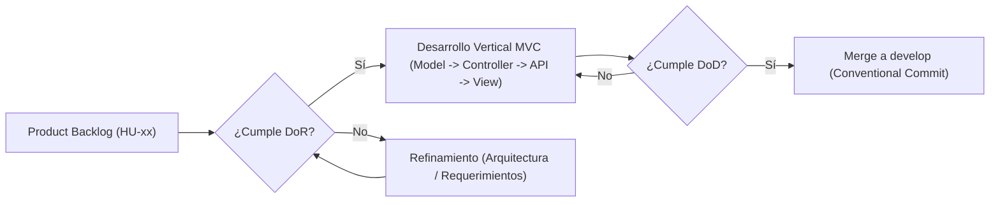

# Definition of Ready (DoR) y Definition of Done (DoD) - project-mvc

Criterios de calidad ágil que determinan cuándo una Historia de Usuario está lista para entrar a desarrollo (**DoR**) y cuándo una funcionalidad o entidad MVC se considera completamente terminada (**DoD**).

---

## 1. Flujo de Calidad de una Historia de Usuario

---

## 2. Definition of Ready (DoR) — Definición de Listo

Antes de iniciar la codificación de cualquier Historia de Usuario (`HU-xx`) o rama de trabajo (`feat/<scope>-crud`), la tarea debe cumplir el 100 % de los siguientes criterios:

| # | Criterio DoR | Verificación en `project-mvc` |
|---|---|---|
| **DoR-01** | **Historia y rol definidos** | La `HU-xx` especifica claramente el actor (`admin` o `user`), el objetivo y el beneficio en [`01-user-story.md`](01-user-story.md). |
| **DoR-02** | **Trazabilidad con RF y RNF** | La historia está vinculada a sus Requerimientos Funcionales (`RF-xx`) y No Funcionales (`RNF-xx`) en [`../requirement/`](../requirement/02-functional-requirement.md). |
| **DoR-03** | **Modelo de datos cerrado** | La tabla, columnas (`snake_case`), llave primaria (`pk_`), restricciones únicas (`uk_`) y llaves foráneas (`fk_` con `ON DELETE RESTRICT`) están definidas en [`../model-data/01-schema.sql`](../model-data/01-schema.sql). |
| **DoR-04** | **Contrato de clases y rutas definido** | Los nombres de archivo (`kebab-case`), clases (`PascalCase`), métodos (`camelCase`) y endpoints (`/api/<entity>`) están especificados en [`../architecture/01-architecture.md`](../architecture/01-architecture.md) y [`../architecture/03-class-diagram.md`](../architecture/03-class-diagram.md). |
| **DoR-05** | **Criterios de aceptación y códigos HTTP claros** | Se conocen los escenarios de éxito (`200`, `201`) y de error (`400 Bad Request`, `404 Not Found`, `409 Conflict`) según [`../architecture/05-sequence-diagram.md`](../architecture/05-sequence-diagram.md). |
| **DoR-06** | **Dependencias previas resueltas** | Si la entidad tiene llaves foráneas (ej. `city` depende de `state`; `user` depende de `person`; `reservation` depende de `user`, `reservation_type` y `city`), las entidades padre ya existen en base de datos y modelo. |
| **DoR-07** | **Prioridad y estimación asignadas** | La historia cuenta con clasificación en la matriz [`03-moscow.md`](03-moscow.md) y estimación en Story Points. |

---

## 3. Definition of Done (DoD) — Definición de Terminado

Una Historia de Usuario (`HU-xx`) o corte vertical de entidad se da por **Terminada (Done)** únicamente cuando cumple todos los puntos de la siguiente lista de verificación por capa:

### 3.1 Capa de Base de Datos y Modelo (`src/model/`)
- [ ] **DoD-01 (SQL Parametrizado):** Todas las consultas SQL usan marcadores `?` con `mysql2/promise` (cero concatenación de cadenas).
- [ ] **DoD-02 (Frontera de Nomenclatura):** El modelo traduce internamente las columnas `snake_case` de MySQL (`person_id`, `postal_code`, `reservation_type_id`) a propiedades `camelCase` (`personId`, `postalCode`, `reservationTypeId`) al recibir y devolver datos.
- [ ] **DoD-03 (Seguridad de Datos):** En el caso de `UserModel`, ninguna consulta devuelve el atributo `password`, y la creación/actualización almacena únicamente el hash generado por `hash-password.js`.

### 3.2 Capa de Controlador y Reglas de Negocio (`src/controller/`)
- [ ] **DoD-04 (Desacoplamiento HTTP):** El controlador contiene la lógica de validación y negocio en JavaScript puro, sin importar `NextRequest` ni `NextResponse`.
- [ ] **DoD-05 (Validación de Entrada - `400`):** Se validan todos los campos requeridos, formatos (como email) y tipos de datos antes de tocar la base de datos.
- [ ] **DoD-06 (Validación de Existencia y FK - `404`):** En operaciones por `id` (`getById`, `update`, `remove`) y en la validación de llaves foráneas (`stateId`, `personId`, `userId`, `reservationTypeId`, `cityId`), se verifica la existencia previa devolviendo error `404 Not Found` cuando no existe.
- [ ] **DoD-07 (Manejo de Conflictos - `409`):** Se controlan tanto los valores únicos repetidos (`email`, `username`, `reservation_type.name`) como la restricción de integridad referencial (`ON DELETE RESTRICT` / `ER_ROW_IS_REFERENCED_2`), traduciéndolos a `409 Conflict`.

### 3.3 Capa de Rutas API (`src/app/api/`)
- [ ] **DoD-08 (Endpoints REST Completos):** Existen `route.js` para la colección (`GET`, `POST`) y `[id]/route.js` para el recurso individual (`GET`, `PUT`, `DELETE`).
- [ ] **DoD-09 (Códigos de Estado Semánticos):** Las rutas responden consistentemente con `200 OK`, `201 Created`, `400 Bad Request`, `404 Not Found`, `409 Conflict` o `500 Internal Server Error`.

### 3.4 Capa de Vista y Páginas (`src/view/` y `src/app/`)
- [ ] **DoD-10 (Componentes MVC React):** Existen los componentes `<Entity>List` y `<Entity>Form` en `src/view/<module>/<entity>/` montados desde sus respectivas páginas `src/app/<module>/<entity>/page.jsx` y `[id]/page.jsx`.
- [ ] **DoD-11 (Experiencia de Usuario Completa):** La interfaz permite listar, crear, editar y eliminar con confirmación, mostrando alertas legibles ante errores de validación o conflicto.

### 3.5 Gobernanza y Control de Versiones (`docs/governance/best-practice.md`)
- [ ] **DoD-12 (100 % Inglés y Notación Correcta):** Todos los archivos, carpetas, variables, funciones y componentes cumplen [`../governance/best-practice.md`](../governance/best-practice.md) (sin tildes, `ñ` ni espacios en identificadores técnicos).
- [ ] **DoD-13 (Flujo Git y Conventional Commits):** El cambio se desarrolló en una rama dedicada desde `develop` (`<type>/<scope>-<description>`) y el commit está redactado en inglés en modo imperativo (`feat(person): ...`).
