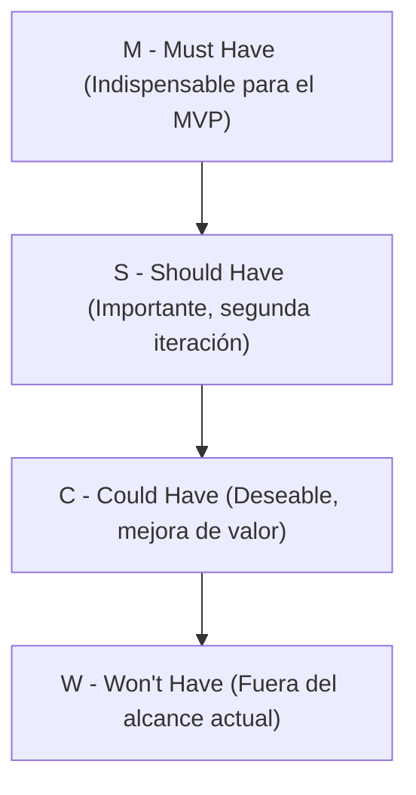

# Priorización MoSCoW - project-mvc

Matriz de priorización ágil bajo el método **MoSCoW** (*Must Have*, *Should Have*, *Could Have*, *Won't Have*) para planificar las entregas incrementales del proyecto `project-mvc`, articulando Historias de Usuario (`HU-xx`), Requerimientos Funcionales (`RF-xx`) y Requerimientos No Funcionales (`RNF-xx`).

---

## 1. Distribución MoSCoW del Proyecto

| Categoría | Significado | Criterio en `project-mvc` |
|---|---|---|
| **M — Must Have** *(Debe tener)* | Requerimientos innegociables para que el sistema sea funcional, íntegro y cumpla la arquitectura MVC y el modelo relacional. | Infraestructura base, esquema MySQL 8.4, seguridad de contraseñas/SQLi y CRUD completo de las 6 entidades en los 3 módulos (`location`, `client`, `reservation`). |
| **S — Should Have** *(Debería tener)* | Funcionalidades importantes que agregan alto valor a la experiencia diferenciada del rol `user` (Cliente), pero que se construyen sobre el CRUD base. | Vista filtrada de *"Consultar mis reservas"* para el cliente, cancelación directa desde su listado y selectores enriquecidos con nombres legibles de catálogos. |
| **C — Could Have** *(Podría tener)* | Mejoras deseables que enriquecen el sistema si el tiempo de la iteración lo permite, sin bloquear la operación esencial. | Flujo completo de inicio de sesión (Login) con sesión activa, control de acceso en interfaz según rol (`admin` vs. `user`), filtros de búsqueda y paginación en tablas. |
| **W — Won't Have** *(No tendrá por ahora)* | Funcionalidades explícitamente excluidas del alcance de esta versión para proteger el foco arquitectónico y la fecha de entrega. | Pasarelas de pago en línea, notificaciones por correo/SMS, calendario de disponibilidad por horas, OAuth con redes sociales o aplicación móvil nativa. |

---

## 2. Matriz MoSCoW Detallada

### 2.1 M — Must Have (Indispensables)

| Código HU / RF / RNF | Elemento Priorizado | Módulo / Capa | Justificación |
|---|---|---|---|
| **HU-01** (`RF-01`..`RF-03`) | CRUD completo de Departamentos (`state`) | `location` | Entidad raíz indispensable para poder registrar ciudades (`fk_city_state`). |
| **HU-02** (`RF-04`..`RF-06`) | CRUD completo de Ciudades (`city`) con validación de `stateId` | `location` | Requisito obligatorio para asociar la ubicación de cualquier reserva (`fk_reservation_city`). |
| **HU-03, HU-04** (`RF-07`..`RF-10`) | Registro y CRUD de Personas (`person`) con `email` único | `client` | Entidad raíz indispensable para crear cuentas de usuario (`fk_user_person`). |
| **HU-05, HU-06** (`RF-11`..`RF-13`) | Creación y CRUD de Usuarios (`user`) con hash de `password` y ocultamiento en lectura | `client` | Entidad requerida para asignar el titular de cada reserva (`fk_reservation_user`). |
| **HU-07** (`RF-14`..`RF-16`) | CRUD de Tipos de Reserva (`reservation_type`) con `name` único | `reservation` | Catálogo maestro obligatorio para clasificar las reservas (`fk_reservation_reservation_type`). |
| **HU-08, HU-11** (`RF-17`, `RF-19`..`RF-21`) | Creación y administración global de Reservas (`reservation`) validando `userId`, `reservationTypeId` y `cityId` | `reservation` | Funcionalidad núcleo del negocio que integra los 3 módulos del proyecto. |
| **RNF-01, RNF-02, RNF-03** | Hashing de contraseñas, no exposición de `password` y consultas SQL 100 % parametrizadas | Seguridad / `model` | Reglas de seguridad inquebrantables definidas en los diagramas de clase y secuencia. |
| **RNF-04, RNF-05, RNF-06** | Arquitectura MVC desacoplada, código 100 % en inglés y mapeo `snake_case ↔ camelCase` | Gobernanza | Estándar obligatorio del repositorio ([`../governance/best-practice.md`](../governance/best-practice.md)). |
| **RNF-07, RNF-08, RNF-09** | Integridad `ON DELETE RESTRICT`, MySQL `utf8mb4` en minúsculas y códigos HTTP (`201`, `400`, `404`, `409`) | Base de datos / API | Garantiza que la aplicación funcione igual en Windows y en contenedores Linux sin corromper datos. |
| **RNF-10, RNF-11, RNF-14** | Orquestación con Docker Compose (`app` + `db`), variables `.env` y `/docs` fuera de `/public` | Infraestructura | Permite levantar todo el entorno con `docker compose up -d --build` de forma segura. |

---

### 2.2 S — Should Have (Importantes)

| Código HU / RF / RNF | Elemento Priorizado | Módulo / Capa | Justificación |
|---|---|---|---|
| **HU-09** (`RF-18`) | Consulta filtrada de *"Mis reservas"* para el rol `user` | `reservation` | Cumple el caso de uso específico del actor Cliente en [`../architecture/04-use-case-diagram.md`](../architecture/04-use-case-diagram.md). |
| **HU-10** (`RF-21`) | Cancelación rápida de reserva propia desde la vista del cliente | `reservation` | Permite la autogestión del cliente (`«extend» Consultar mis reservas`). |
| **RF-22** | Flujo guiado de registro integral de Cliente (`Person` + `User`) | `client` | Mejora la experiencia del cliente nuevo al unificar los pasos de registro. |
| **RNF-12, RNF-13** | Retroalimentación visual enriquecida (estados de carga, confirmaciones y selectores con nombres de catálogos en vez de IDs planos) | `view` | Eleva la usabilidad validada en el prototipo de Design Thinking ([`../prototype/01-design-thinking.md`](../prototype/01-design-thinking.md)). |

---

### 2.3 C — Could Have (Deseables)

| Código HU / RF / RNF | Elemento Priorizado | Módulo / Capa | Justificación |
|---|---|---|---|
| **HU-12** (`RF-23`, `RF-24`) | Inicio de sesión (`Login`) y diferenciación activa de vistas/permisos por rol (`admin` vs. `user`) | `client` / Transversal | Documentado como supuesto por validar en [`../architecture/04-use-case-diagram.md`](../architecture/04-use-case-diagram.md#L34-L37) (requiere columna `role` o manejo de sesión). |
| **Mejora UI-01** | Búsqueda por texto y filtrado por ciudad o tipo de reserva en `ReservationList` | `view/reservation` | Facilita la localización de registros cuando el volumen de datos crece. |
| **Mejora DB-01** | Script de datos semilla (`02-seed.sql`) con departamentos, ciudades y tipos de reserva iniciales | `docs/model-data/` | Acelera las pruebas manuales y demostraciones del sistema recién levantado en Docker. |

---

### 2.4 W — Won't Have (Fuera del Alcance Actual)

| Código | Funcionalidad Excluida en esta Versión | Razón de Exclusión |
|---|---|---|
| **EX-01** | Pasarela de pagos y facturación electrónica | No forma parte del modelo de dominio ni de los diagramas aprobados. |
| **EX-02** | Envío de correos electrónicos transaccionales (SMTP) o SMS | Requiere servicios externos fuera del alcance académico del contenedor base (`app` + `db`). |
| **EX-03** | Autenticación federada con terceros (Google / GitHub OAuth) | La autenticación del modelo se basa en la entidad propia `user` (`username` y `password`). |
| **EX-04** | Gestión de disponibilidad por calendario/fechas y cupos | La tabla `reservation` definida en el modelo relacional se enfoca en la relación estructural (`user_id`, `reservation_type_id`, `city_id`). |
