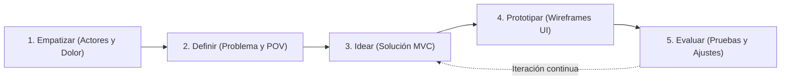
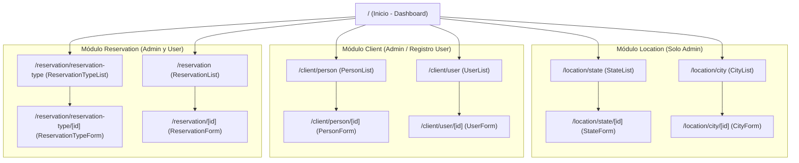

# Design Thinking y Prototipado - project-mvc

Aplicación de la metodología **Design Thinking** en sus 5 etapas (Empatizar, Definir, Idear, Prototipar y Evaluar) para el diseño centrado en el usuario del sistema de gestión de reservas y ubicaciones **`project-mvc`**.

---

## Flujo de las 5 Etapas



---

## 1. Empatizar (Empathize)

En esta fase comprendemos las necesidades, motivaciones y frustraciones de los dos actores principales que interactúan con el sistema: el **Cliente (`user`)** y el **Administrador (`admin`)**.

### 1.1 Perfiles de Usuario (User Personas)

| Atributo | Perfil 1: Cliente (`user`) | Perfil 2: Administrador (`admin`) |
|---|---|---|
| **Nombre ficticio** | Laura Gómez (Viajera / Solicitante de servicios) | Carlos Méndez (Coordinador Operativo) |
| **Objetivo principal** | Registrarse rápidamente, elegir una ciudad y un tipo de reserva, y gestionar sus reservas sin trámites manuales. | Mantener actualizados los catálogos de departamentos, ciudades y tipos de reserva, y supervisar todas las reservas y cuentas de usuario. |
| **Frustraciones (Pain Points)** | - Formularios confusos sin mensajes claros de error.<br>- No saber en qué ciudad o bajo qué modalidad quedó registrada su reserva.<br>- No poder consultar o cancelar sus reservas fácilmente. | - Datos duplicados (correos o nombres de usuario repetidos).<br>- Eliminación accidental de ciudades o tipos de reserva que ya tienen reservas activas.<br>- Falta de trazabilidad entre la persona registrada y su cuenta de usuario. |
| **Necesidades** | Interfaz limpia, confirmación inmediata y vista filtrada con solo sus propias reservas. | Panel centralizado con operaciones CRUD completas, validaciones de integridad referencial y alertas claras (`409 Conflict`, `400 Bad Request`). |

### 1.2 Mapa de Empatía Resumido

| Dimensión | Cliente (`user`) | Administrador (`admin`) |
|---|---|---|
| **¿Qué piensa y siente?** | "Quiero asegurar mi reserva en pocos clics y estar seguro de que quedó guardada." | "Necesito que el sistema impida errores de captura y proteja la integridad de la base de datos." |
| **¿Qué ve?** | Formularios web desde su navegador en computador o dispositivo móvil. | Tablas de administración con listados, botones de acción (Crear, Editar, Eliminar) y estados de catálogo. |
| **¿Qué dice y hace?** | Busca la ciudad destino, selecciona el tipo de reserva y verifica su listado personal. | Registra primero los departamentos (`state`), luego las ciudades (`city`) y los tipos de reserva (`reservation_type`) para habilitar la operación. |
| **Esfuerzos (Dolores)** | Reintentar registros cuando un formulario falla sin explicar qué campo está mal. | Corregir registros huérfanos o inconsistencias cuando no existen llaves foráneas estrictas. |
| **Resultados (Ganancias)** | Autogestión rápida de sus reservas con retroalimentación visual inmediata. | Control total de los 3 módulos (`location`, `client`, `reservation`) con datos íntegros. |

---

## 2. Definir (Define)

### 2.1 Declaración del Problema (Problem Statement)

> Los clientes y administradores necesitan una plataforma web centralizada que vincule de forma íntegra la **identidad de las personas (`person` / `user`)**, la **ubicación geográfica (`state` / `city`)** y el **catálogo de servicios (`reservation_type`)**, porque la gestión desarticulada genera duplicidad de cuentas, reservas en ubicaciones inexistentes y pérdida de control operativo.

### 2.2 Punto de Vista (Point of View - POV)

| Rol | Usuario | Necesita | Porque |
|---|---|---|---|
| **`user`** | Un cliente registrado en la plataforma | crear, consultar y cancelar sus propias reservas eligiendo una ciudad y un tipo de reserva válidos | requiere autonomía, rapidez y certeza sobre el estado de sus solicitudes sin depender de soporte manual. |
| **`admin`** | Un administrador del sistema | gestionar los catálogos maestros (`state`, `city`, `reservation_type`), las personas (`person`), usuarios (`user`) y todas las reservas (`reservation`) bajo reglas de integridad referencial | debe garantizar que ninguna reserva apunte a datos inexistentes y que ningún catálogo en uso sea eliminado accidentalmente. |

### 2.3 Preguntas "¿Cómo podríamos...?" (How Might We - HMW)

1. **HMW-01:** ¿Cómo podríamos guiar al usuario para que complete su registro de persona y cuenta sin duplicar correos ni nombres de usuario?
2. **HMW-02:** ¿Cómo podríamos evitar que un administrador elimine un departamento, ciudad, persona o tipo de reserva que ya tiene registros asociados?
3. **HMW-03:** ¿Cómo podríamos ofrecer una interfaz uniforme y predecible en los 3 módulos (`location`, `client`, `reservation`) que reduzca la curva de aprendizaje?

---

## 3. Idear (Ideate)

A partir de las preguntas HMW, se seleccionaron las siguientes soluciones de diseño y arquitectura:

1. **Patrón de Interfaz Consistente (Lista + Formulario por Entidad):**
   - Todas las entidades siguen el estándar visual `<Entity>List` (tabla con acciones de edición y borrado) y `<Entity>Form` (creación y actualización con validación previa).
2. **Validación en Doble Capa y Retroalimentación HTTP Semántica:**
   - Validación de campos obligatorios en formulario y en el controlador (`400 Bad Request`).
   - Verificación de unicidad en `person.email`, `user.username` y `reservation_type.name` (`409 Conflict`).
   - Protección con `ON DELETE RESTRICT` en MySQL para impedir borrados que rompan la integridad (`409 Conflict` informado con mensaje legible al usuario).
3. **Separación de Experiencia por Rol (`admin` vs. `user`):**
   - El **Administrador (`admin`)** accede al panel completo de los 3 módulos (`location`, `client`, `reservation`).
   - El **Cliente (`user`)** accede al flujo de registro/inicio de sesión y a la vista enfocada en crear y administrar sus propias reservas.

---

## 4. Prototipar (Prototype)

### 4.1 Mapa de Navegación del Prototipo



### 4.2 Wireframe 1: Dashboard Principal (`/`)

```text
+-----------------------------------------------------------------------------------+
| [MVC] project-mvc     Inicio | Departamentos | Ciudades | Personas | Usuarios ... |
+-----------------------------------------------------------------------------------+
|                                                                                   |
|  SISTEMA DE GESTIÓN DE RESERVAS Y UBICACIONES (MVC)                               |
|  Administra catálogos geográficos, clientes, usuarios y reservas.                 |
|                                                                                   |
|  +-----------------------+  +-----------------------+  +-----------------------+  |
|  | MÓDULO LOCATION       |  | MÓDULO CLIENT         |  | MÓDULO RESERVATION    |  |
|  | - Departamentos       |  | - Personas            |  | - Tipos de Reserva    |  |
|  |   [Abrir] [/api/state]|  |   [Abrir] [/api/person|  |   [Abrir] [/api/...]  |  |
|  | - Ciudades            |  | - Usuarios            |  | - Reservas            |  |
|  |   [Abrir] [/api/city] |  |   [Abrir] [/api/user] |  |   [Abrir] [/api/...]  |  |
|  +-----------------------+  +-----------------------+  +-----------------------+  |
|                                                                                   |
+-----------------------------------------------------------------------------------+
```

### 4.3 Wireframe 2: Vista de Listado Estándar (`<Entity>List`)

Aplicable a `PersonList`, `UserList`, `StateList`, `CityList`, `ReservationTypeList` y `ReservationList`:

```text
+-----------------------------------------------------------------------------------+
| [MVC] project-mvc                                      Rol activo: [Admin / User] |
+-----------------------------------------------------------------------------------+
|  GESTIÓN DE RESERVAS                                      [+ Nueva Reserva]       |
|  -------------------------------------------------------------------------------  |
|  | ID  | Nombre de Reserva    | Usuario   | Tipo de Reserva | Ciudad    |Acción|  |
|  |-----|----------------------|-----------|-----------------|-----------|------|  |
|  | 1   | Reserva Hotel Centro | lgomez    | Alojamiento     | Medellín  |[E][X]|  |
|  | 2   | Sala Ejecutiva Norte | cmendez   | Empresarial     | Bogotá    |[E][X]|  |
|  -------------------------------------------------------------------------------  |
|  Mostrando 2 registros                                                            |
+-----------------------------------------------------------------------------------+
  [E] = Editar (/reservation/[id])    [X] = Eliminar (con confirmación modal/alerta)
```

### 4.4 Wireframe 3: Vista de Formulario Estándar (`<Entity>Form`)

Ejemplo del prototipo de creación/edición de reserva (`ReservationForm`):

```text
+-----------------------------------------------------------------------------------+
|  CREAR / EDITAR RESERVA                                     [<- Volver al listado]|
+-----------------------------------------------------------------------------------+
|  +-----------------------------------------------------------------------------+  |
|  | (!) Banner de validación (solo si ocurre 400 / 404 / 409):                  |  |
|  |     "Debe seleccionar una ciudad y un tipo de reserva válidos."             |  |
|  +-----------------------------------------------------------------------------+  |
|                                                                                   |
|  Nombre de la reserva *                                                           |
|  [ Reserva Conferencia Anual                                                   ]  |
|                                                                                   |
|  Usuario titular *                     Tipo de reserva *                          |
|  [ Seleccionar usuario...          v ] [ Seleccionar tipo...                 v ]  |
|                                                                                   |
|  Ciudad *                                                                         |
|  [ Seleccionar ciudad...           v ]                                            |
|                                                                                   |
|                                               [ Cancelar ]  [ Guardar Reserva ]   |
+-----------------------------------------------------------------------------------+
```

---

## 5. Evaluar / Testear (Test)

Criterios de evaluación aplicados sobre el prototipo junto con los casos de uso ([`../architecture/04-use-case-diagram.md`](../architecture/04-use-case-diagram.md)) y diagramas de secuencia ([`../architecture/05-sequence-diagram.md`](../architecture/05-sequence-diagram.md)):

| Escenario de Prueba | Qué se evalúa en el prototipo | Resultado esperado en la UI |
|---|---|---|
| **Registro con email duplicado** | Claridad del error cuando una persona intenta usar un correo ya registrado (`409 Conflict`). | El formulario mantiene los datos escritos y muestra alerta clara: *"El email ya está registrado"*. |
| **Creación de reserva con catálogos** | Facilidad para elegir `user`, `reservation_type` y `city` mediante selectores desplegables en vez de digitar IDs numéricos. | El usuario selecciona por nombre legible (`Medellín`, `Alojamiento`) y el formulario envía `cityId` y `reservationTypeId`. |
| **Intento de borrar registro padre en uso** | Prevención de errores cuando el `admin` intenta borrar un `state` con `city` asociadas o un `user` con `reservation`. | El sistema bloquea la acción (`ON DELETE RESTRICT`) y notifica que el registro tiene dependencias asociadas. |
| **Privacidad de contraseñas** | Seguridad visual en `UserList` y `UserForm`. | El campo `password` se captura como `type="password"` y jamás se muestra en las tablas ni respuestas JSON. |
