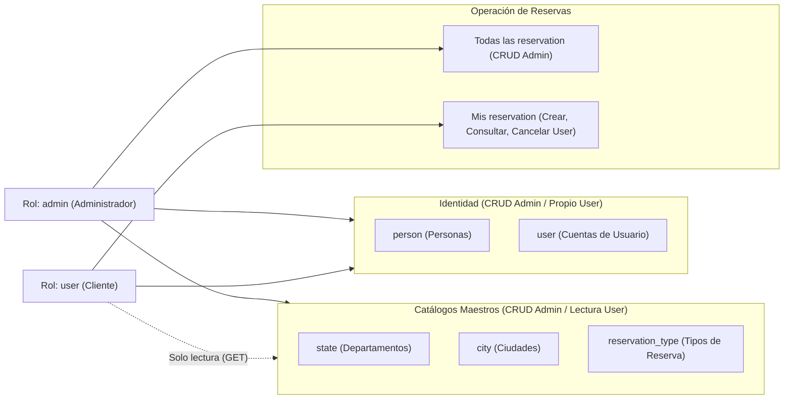

# Roles y Responsabilidades (`admin` y `user`) - project-mvc

Definición formal de los roles del sistema, sus responsabilidades de negocio, el alcance de sus permisos sobre cada módulo (`location`, `client`, `reservation`) y su correspondencia con los diagramas de casos de uso ([`../architecture/04-use-case-diagram.md`](../architecture/04-use-case-diagram.md)).

---

## 1. Definición de Roles

| Rol Técnico | Nombre de Negocio | Descripción General |
|---|---|---|
| **`admin`** | Administrador | Rol con control total sobre la plataforma. Administra los catálogos maestros (`state`, `city`, `reservation_type`), gestiona el ciclo de vida completo de personas (`person`) y cuentas de usuario (`user`), y supervisa o administra todas las reservas (`reservation`) del sistema. |
| **`user`** | Cliente / Usuario Estándar | Persona registrada en el sistema que accede con sus credenciales (`username` y `password`) para autogestionar sus propias reservas (`reservation`): crear nuevas reservas seleccionando un tipo de reserva y una ciudad, consultar únicamente las reservas a su nombre y cancelarlas cuando lo requiera. |

---

## 2. Responsabilidades Detalladas por Rol

### 2.1 Rol Administrador (`admin`)

1. **Gestión del Módulo de Ubicación (`location`):**
   - Crear, listar, consultar, actualizar y eliminar departamentos/estados (`state`).
   - Crear, listar, consultar, actualizar y eliminar ciudades (`city`), asegurando que cada ciudad pertenezca a un `state` válido.
   - Garantizar que no se eliminen departamentos con ciudades asociadas ni ciudades con reservas activas (`ON DELETE RESTRICT`).
2. **Gestión del Módulo de Clientes (`client`):**
   - Administrar el padrón de personas (`person`), validando la unicidad del correo electrónico (`email`).
   - Administrar las cuentas de usuario (`user`), vinculándolas a una persona existente (`person_id`) y asegurando el almacenamiento cifrado (hash) de contraseñas.
3. **Gestión del Módulo de Reservas (`reservation`):**
   - Administrar el catálogo de tipos de reserva (`reservation_type`), manteniendo nombres únicos y descripciones claras.
   - Consultar, crear, modificar o eliminar cualquier reserva (`reservation`) registrada en el sistema para soporte u operación.

### 2.2 Rol Cliente / Usuario (`user`)

1. **Registro e Identidad (`client`):**
   - Registrarse en el sistema creando sus datos personales (`person`) y su cuenta de acceso (`user`).
   - Iniciar sesión con su `username` y `password`.
2. **Autogestión de Reservas (`reservation`):**
   - Consultar los catálogos disponibles de ciudades (`city`) y tipos de reserva (`reservation_type`) para elegir dónde y qué reservar.
   - Crear reservas (`reservation`) asociadas exclusivamente a su propio `user_id`.
   - Consultar el listado de **sus propias reservas** (sin acceso a las reservas de otros usuarios).
   - Cancelar (eliminar) únicamente reservas de su propiedad.

---

## 3. Matriz de Permisos por Entidad y Operación (RBAC)

| Módulo | Entidad | Endpoint API | Operación | `admin` | `user` | Condición / Regla de Negocio para `user` |
|---|---|---|---|---|---|---|
| **location** | `state` | `GET /api/state` | Listar / Consultar | Sí | Lectura | Puede listar departamentos para filtros de ubicación |
| **location** | `state` | `POST / PUT / DELETE /api/state` | Crear / Editar / Borrar | Sí | No | Exclusivo para administración de catálogos |
| **location** | `city` | `GET /api/city` | Listar / Consultar | Sí | Lectura | Necesario para seleccionar la ciudad al crear una reserva |
| **location** | `city` | `POST / PUT / DELETE /api/city` | Crear / Editar / Borrar | Sí | No | Exclusivo para administración de catálogos |
| **client** | `person` | `POST /api/person` | Registrar persona | Sí | Sí | Durante su propio proceso de registro |
| **client** | `person` | `GET / PUT / DELETE /api/person` | Gestionar personas | Sí | Propio | `user` solo puede ver/actualizar sus propios datos personales |
| **client** | `user` | `POST /api/user` | Crear cuenta | Sí | Sí | Durante su propio proceso de registro |
| **client** | `user` | `GET / PUT / DELETE /api/user` | Gestionar usuarios | Sí | Propio | `user` solo puede consultar/actualizar su propia cuenta |
| **reservation** | `reservation_type` | `GET /api/reservation-type` | Listar / Consultar | Sí | Lectura | Necesario para elegir el tipo de reserva en el formulario |
| **reservation** | `reservation_type` | `POST / PUT / DELETE /api/reservation-type` | Crear / Editar / Borrar | Sí | No | Exclusivo para administración de catálogos |
| **reservation** | `reservation` | `GET /api/reservation` | Listar reservas | Todas | Propias | `admin` ve todas; `user` solo ve aquellas donde `user_id` es el suyo |
| **reservation** | `reservation` | `POST /api/reservation` | Crear reserva | Sí | Sí | `user` solo puede crear reservas a su propio `user_id` |
| **reservation** | `reservation` | `PUT /api/reservation/[id]` | Actualizar reserva | Sí | Propia | `user` solo puede modificar reservas que le pertenezcan |
| **reservation** | `reservation` | `DELETE /api/reservation/[id]` | Cancelar / Eliminar | Sí | Propia | `user` puede cancelar sus propias reservas; `admin` cualquiera |

---

## 4. Diagrama de Alcance por Rol



---

## 5. Nota de Implementación en Base de Datos

Tal como se documenta en [`../architecture/04-use-case-diagram.md`](../architecture/04-use-case-diagram.md#L36), el esquema base en [`../model-data/01-schema.sql`](../model-data/01-schema.sql) mantiene las 6 tablas originales de los diagramas (`person`, `user`, `state`, `city`, `reservation_type`, `reservation`). Cuando se habilite el control de acceso por rol en base de datos, se recomienda incorporar en la tabla `user` la columna:

```sql
role ENUM('admin', 'user') NOT NULL DEFAULT 'user'
```
