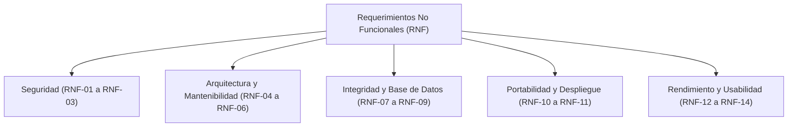

# Requerimientos No Funcionales (RNF) - project-mvc

Especificación y listado oficial de los **Requerimientos No Funcionales (`RNF-01` a `RNF-14`)** del sistema `project-mvc`, estableciendo los atributos de calidad de arquitectura, seguridad, base de datos, usabilidad, rendimiento y gobernanza de código.

---

## 1. Categorías de Calidad

---

## 2. Listado de Requerimientos No Funcionales

### 2.1 Seguridad (`Security`)

| Código | Nombre | Descripción | Métrica / Criterio de Verificación |
|---|---|---|---|
| **RNF-01** | Cifrado de contraseñas (Hashing) | Las contraseñas de la tabla `user` nunca deben almacenarse ni transmitirse en texto plano; deben procesarse mediante un algoritmo de hash seguro (`bcrypt` / `bcryptjs`) antes de persistirse. | 100 % de los registros en `user.password` almacenan un hash irreversible (`VARCHAR(255)`). |
| **RNF-02** | Ocultamiento de credenciales en respuestas | Ningún método de `UserModel`, `UserController` ni endpoint `/api/user` debe devolver el atributo `password` en las respuestas JSON. | 0 % de apariciones de la propiedad `password` en respuestas de `GET`, `POST` o `PUT` de `/api/user`. |
| **RNF-03** | Prevención de Inyección SQL (SQLi) | Todas las consultas a MySQL en la capa `src/model/` deben ejecutarse mediante sentencias preparadas/parametrizadas (`?`) usando `mysql2/promise`. | 0 concatenaciones de variables de usuario en strings SQL dentro de `src/model/**`. |

---

### 2.2 Arquitectura y Mantenibilidad (`Architecture & Maintainability`)

| Código | Nombre | Descripción | Métrica / Criterio de Verificación |
|---|---|---|---|
| **RNF-04** | Desacoplamiento estricto por capas MVC | El sistema debe separar responsabilidades en 4 niveles (`app/route` → `controller` → `model` → `MySQL` y `app/page` → `view`): las vistas no acceden a la BD, los modelos no importan objetos HTTP de Next.js y las rutas solo delegan al controlador. | Revisión estructural conforme a [`../architecture/01-architecture.md`](../architecture/01-architecture.md) y [`../architecture/03-class-diagram.md`](../architecture/03-class-diagram.md). |
| **RNF-05** | Estandarización de nomenclatura e idioma | Todo el código técnico (carpetas, archivos, variables, clases, tablas, columnas, rutas, ramas y commits) debe escribirse 100 % en inglés, en singular y respetando la notación por capa (`kebab-case`, `snake_case`, `camelCase`, `PascalCase`, `UPPER_SNAKE_CASE`). | Cumplimiento del 100 % de las reglas definidas en [`../governance/best-practice.md`](../governance/best-practice.md). |
| **RNF-06** | Mapeo uniforme entre Base de Datos y API | La capa `model` debe actuar como única frontera de traducción entre `snake_case` (columnas SQL como `person_id`, `reservation_type_id`, `postal_code`) y `camelCase` (propiedades JS/JSON como `personId`, `reservationTypeId`, `postalCode`). | 100 % de los payloads JSON de la API usan `camelCase` y 100 % del SQL usa `snake_case`. |

---

### 2.3 Integridad de Datos y Base de Datos (`Data Integrity`)

| Código | Nombre | Descripción | Métrica / Criterio de Verificación |
|---|---|---|---|
| **RNF-07** | Integridad referencial estricta | Todas las relaciones entre tablas (`person → user`, `user → reservation`, `reservation_type → reservation`, `state → city`, `city → reservation`) deben contar con llaves foráneas en InnoDB con política `ON DELETE RESTRICT`. | Ningún registro padre con hijos asociados puede eliminarse en MySQL; la API responde `409 Conflict`. |
| **RNF-08** | Soporte de codificación internacional | La base de datos `project_mvc` y todas sus tablas deben utilizar el conjunto de caracteres `utf8mb4` y colación `utf8mb4_unicode_ci`, con nombres de tabla y columna en minúsculas. | Compatibilidad total con tildes y `ñ` en los datos almacenados y ejecución sin errores en contenedores Linux (case-sensitive). |
| **RNF-09** | Contrato HTTP y JSON estandarizado | Los endpoints REST bajo `src/app/api/` deben responder siempre en formato JSON utilizando los códigos de estado semánticos definidos en la arquitectura (`200 OK`, `201 Created`, `400 Bad Request`, `404 Not Found`, `409 Conflict`, `500 Internal Server Error`). | Consistencia del 100 % de respuestas HTTP frente a [`../architecture/05-sequence-diagram.md`](../architecture/05-sequence-diagram.md#L29-L36). |

---

### 2.4 Portabilidad y Despliegue (`Portability & Deployment`)

| Código | Nombre | Descripción | Métrica / Criterio de Verificación |
|---|---|---|---|
| **RNF-10** | Contenerización con Docker Compose | La aplicación (`app` en Next.js `:3000`) y la base de datos (`db` en MySQL 8.4 `:3306`) deben levantarse de forma reproducible con un solo comando (`docker compose up -d --build`) comunicándose por red interna. | Despliegue funcional desde cero con inicialización automática de [`../model-data/01-schema.sql`](../model-data/01-schema.sql) y healthcheck de BD. |
| **RNF-11** | Persistencia y externalización de configuración | Los datos de MySQL deben persistir en un volumen dedicado (`mysql-data`) y las credenciales de conexión (`DB_HOST`, `DB_PORT`, `DB_USER`, `DB_PASSWORD`, `DB_NAME`) deben inyectarse por variables de entorno (`.env`) sin exponerse en el repositorio. | Los datos sobreviven a `docker compose down` y `.env` está excluido en `.gitignore`. |

---

### 2.5 Rendimiento y Usabilidad (`Performance & Usability`)

| Código | Nombre | Descripción | Métrica / Criterio de Verificación |
|---|---|---|---|
| **RNF-12** | Tiempo de respuesta de la API | Las operaciones CRUD sobre las 6 entidades deben responder de manera ágil mediante el uso de un pool de conexiones reutilizable en `mysql2/promise`. | Tiempo de respuesta promedio `< 500 ms` en entorno local/Docker para consultas y transacciones CRUD. |
| **RNF-13** | Usabilidad y retroalimentación visual | Los formularios y listados en `src/view/` deben ser responsivos, mostrar estados de carga, pedir confirmación antes de eliminar y presentar mensajes claros en español cuando ocurran errores (`400`, `404`, `409`). | El usuario comprende la causa del error o éxito de cada operación sin inspeccionar la consola del navegador. |
| **RNF-14** | Seguridad de la documentación e infraestructura | Los scripts SQL (`01-schema.sql`) y la documentación técnica deben residir en `/docs` en la raíz del proyecto y nunca dentro de `/public`, evitando su exposición estática por HTTP. | La ruta `http://localhost:3000/docs/...` retorna `404 Not Found`. |
